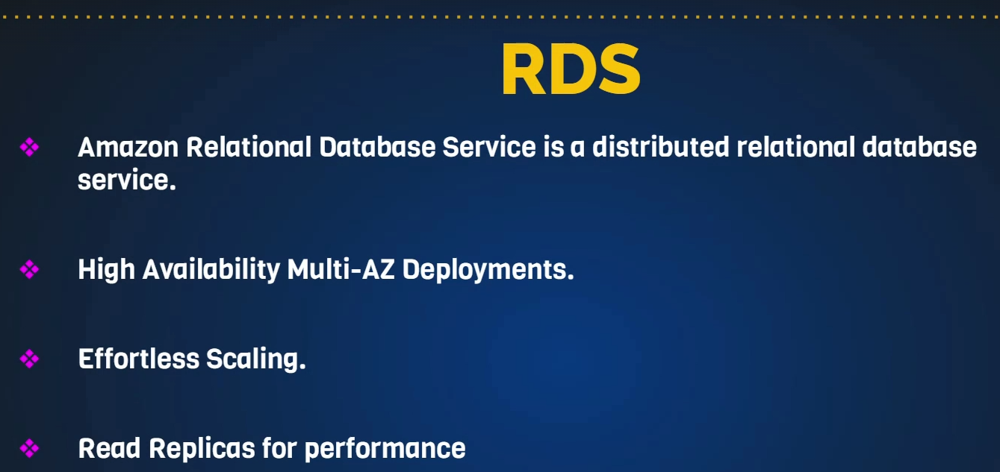
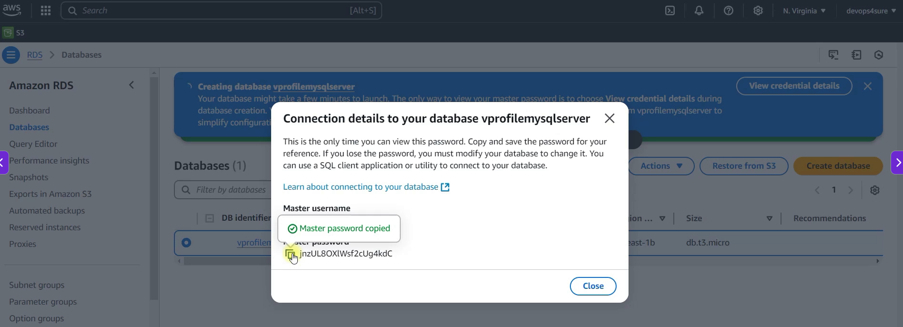

# Relation Database Service (RDS)





```sh
Amazon RDS on AWS Console   
└── Navigate to AWS GUI and search for RDS service
    ├── Click on `Databases` > `Create database`
    ├── Choose a database creation method 
    │   └── Standard create
    ├── Engine options
    │   ├── Aurora (MySQL Compatible)
    │   ├── Aurora (PostgreSQL Compatible)
    │   ├── MySQL # Use this one here
    │   ├── PostgreSQL
    │   ├── MariaDB
    │   ├── Oracle
    │   ├── Microsoft SQL Server
    │   └── IBM Db2
    ├── Engine version 
    │   └── MySQL 8.0.39 # The default one
    ├── Templates 
    │   └── Dev/Test
    ├── Availability & durability 
    │   └── Multi-AZ DB cluster deployment (3 instances)
    │   └── Multi-AZ DB instance deployment (2 instances)
    │   └── Single-AZ DB instance deployment (1 instance) # Use this one here
    ├── Settings 
    │   ├── DB instance identifier: VProfileMySQLServer
    ├── Credentials settings 
    │   ├── Master username: admin
    │   ├── Credentials Management > Self managed > Autogenerated password
    ├── Instance configuration 
    │   ├── Burstable classes: db.t3.micro
    ├── Storage 
    │   ├── Storage type: General Purpose SSD (gp3)
    │   ├── Allocated storage: 20 GiB
    │   └── Additional storage configuration > Enable storage autoscaling: Yes # Default setting
    └── Connectivity 
        ├── Compute resource > Don't connect to an EC2 compute resource
        ├── DB Subnet group: default 
        ├── Public acxcessibility > No 
        ├── VPC security groups > Create new 
        │   ├── New VPC SG name > vproSQLRDS-sg
        │   └── Availability Zone > No preference
        ├── Additional configuration
        │   └── Port Number > 3306
        ├── Database authentication 
        ├── Monitoring # Skip for now by unchecking the option
        │  └── Granularity > 60 seconds
        ├── Additional configuration > Database options 
        │  └── initial database name: accounts
        ├── Backup # Skip for now by unchecking the option. In reel time we always need backups for production databases.
        │  └──  Backup retention period: 7 days
        ├── Encryption 
        │  └──  Uncheck it for now
        ├── Maintenance 
        │  └──  Uncheck it for now
        ├──  
        └── Create Database 
```

## Username and password



## Create EC2

```sh
EC2 # Instructions for setting up an EC2 instance to connect to the RDS database
└── Instances 
    ├── Launch instance
    ├── Name and tags
    │   └── mysqlClient
    ├── Application and OS Images (Amazon Machine Image)  
    │   └── Choose Ubuntu as the operating system for the EC2 instance
    │       └── Ubuntu server 24.04 LTS > Free tier eleigible
    ├── Create a key pair 
    │  ├──  Key pair name > rdssqlclient
    │  ├──  Key pair type > RSA
    │  ├──  Private key file format > .pem
    │  └──  Create key pair
    └── Network settings
        ├── VPC > Default vpc
        ├── Auto assign public ip
        └── Firewall (Security group) > Create new
        │   ├── security group name > mysqlClient-sg
        │   ├── Description > mysqlClient-sg
        │   ├── Security group rules > Allow SSH and MySQL access
        │   └── Inbound SG rules
        │       └── Rule 1: Allow SSH (port 22) from your IP
        └── Launch instance
```

## Connect to EC2 DB Client

```sh
$ ssh -i "DecodingDevOps.pem" ubuntu@ec2-3-138-192-65.us-east-2.compute.amazonaws.com
The authenticity of host 'ec2-3-138-192-65.us-east-2.compute.amazonaws.com (3.138.192.65)' can't be established.
ED25519 key fingerprint is: SHA256:Vnvl87+q8+Baw15Q+MwUB1HPwNktorQo2mKZkObtFfU
This key is not known by any other names.
Are you sure you want to continue connecting (yes/no/[fingerprint])? yes
Warning: Permanently added 'ec2-3-138-192-65.us-east-2.compute.amazonaws.com' (ED25519) to the list of known hosts.
Welcome to Ubuntu 24.04.4 LTS (GNU/Linux 6.17.0-1017-aws x86_64)
#
 * Documentation:  https://help.ubuntu.com
 * Management:     https://landscape.canonical.com
 * Support:        https://ubuntu.com/pro
#
 System information as of Wed Oct  7 00:36:30 UTC 2026
#
  System load:  0.08              Temperature:           -273.1 C
  Usage of /:   26.6% of 6.71GB   Processes:             111
  Memory usage: 25%               Users logged in:       0
  Swap usage:   0%                IPv4 address for ens5: 172.31.39.31
#
Expanded Security Maintenance for Applications is not enabled.
#
0 updates can be applied immediately.
#
Enable ESM Apps to receive additional future security updates.
See https://ubuntu.com/esm or run: sudo pro status
#
The list of available updates is more than a week old.
To check for new updates run: sudo apt update
#
The programs included with the Ubuntu system are free software;
the exact distribution terms for each program are described in the
individual files in /usr/share/doc/*/copyright.
#
Ubuntu comes with ABSOLUTELY NO WARRANTY, to the extent permitted by
applicable law.
#
To run a command as administrator (user "root"), use "sudo <command>".
See "man sudo_root" for details.
```

## Install packages

```sh
ubuntu@ip-172-31-39-31:~$ sudo -i

root@ip-172-31-39-31:~# apt update

root@ip-172-31-39-31:~# apt install mysql-client -y
```

## Connect to DB

```sh
mysql -h vprofilemysqlserver.c7oescqy4eh4.us-east-2.rds.amazonaws.com -u admin -padmin123
mysql: [Warning] Using a password on the command line interface can be insecure.
Welcome to the MySQL monitor.  Commands end with ; or \g.
Your MySQL connection id is 57
Server version: 8.4.9 Source distribution

Copyright (c) 2000, 2026, Oracle and/or its affiliates.

Oracle is a registered trademark of Oracle Corporation and/or its
affiliates. Other names may be trademarks of their respective
owners.

Type 'help;' or '\h' for help. Type '\c' to clear the current input statement.

mysql>
```

```sh
mysql> show databases;
+--------------------+
| Database           |
+--------------------+
| accounts           |
| information_schema |
| mysql              |
| performance_schema |
| sys                |
+--------------------+
5 rows in set (0.02 sec)


```


